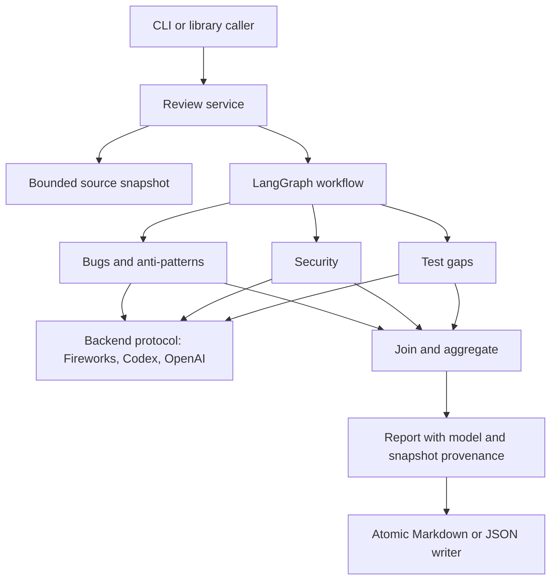

# LangGraph coding review

Three specialist reviewers examine one bounded source snapshot: correctness and anti-patterns, security, and test gaps. LangGraph runs the specialists concurrently; a deterministic orchestrator waits for all three, checks source citations, merges exact duplicates, and ranks findings by severity.

## Quick start

Python 3.10+ is required. The default backend is **Fireworks AI**, using **MiniMax M3.1 Flash** (`accounts/fireworks/models/minimax-m3p1-flash`). Fireworks requires its own API key and billing; ChatGPT Pro does not fund this backend.

```bash
python3 -m venv .venv
source .venv/bin/activate
pip install -e '.[test,dev]'
export FIREWORKS_API_KEY='your-fireworks-key'
coding-review ./examples --snapshot-only
coding-review ./examples --output review-report.md
coding-review ./examples --format json --output review-report.json
```

For this workspace, use `.venv313/bin/python -m coding_review` in place of `coding-review`. The previous `python -m coding_review.cli` entry point also works. The key must be exported in the same Terminal where you run the command; a `.env` file is not loaded automatically.

The Fireworks adapter uses the documented `https://api.fireworks.ai/inference/v1` endpoint, JSON-schema responses, and the existing OpenAI-compatible SDK transport. It sends only `FIREWORKS_API_KEY` to Fireworks and does not use `OPENAI_API_KEY`, OpenAI endpoint settings, or Codex authentication. Requests have two provider retries. Truncated, empty, refused, invalid, or abnormal responses fail explicitly rather than becoming successful empty reviews. The completion budget is 32,768 tokens per specialist, including reasoning, with low reasoning effort to reserve room for the final JSON report. Requested and provider-reported model names are retained separately in reports.

Override the model with `--model`, or set `FIREWORKS_MODEL` to a Fireworks model/deployment resource. Precedence is `--model`, then `FIREWORKS_MODEL`, then the MiniMax default. `REVIEW_MODEL` applies only to the OpenAI API backend.

The official [Fireworks model catalog](https://fireworks.ai/models) lists MiniMax M3.1 Flash. The adapter follows Fireworks' [structured-output guide](https://docs.fireworks.ai/structured-responses/structured-response-formatting) and [Chat Completions API](https://docs.fireworks.ai/api-reference/post-chatcompletions). Model availability and your account access are confirmed only by a live request.

### Alternative backends

Codex remains available explicitly, using ChatGPT authentication and your plan's usage allowance:

```bash
codex login
codex login status
coding-review ./examples --backend codex --output review-report-codex.md
```

It removes API-key variables from child processes, requires ChatGPT sign-in, and does not fall back to API billing. Backend behavior is described in the [official Codex documentation](https://learn.chatgpt.com/docs/non-interactive-mode). If `codex` on PATH has a missing dependency or points to the wrong installation, use `--codex-executable` with the correct binary path. This machine's bundled binary is `/Applications/ChatGPT.app/Contents/Resources/codex-cli/CodexCLI.app/Contents/MacOS/codex`.

The Codex integration was validated against CLI 0.164.0-alpha.11.1. It uses ephemeral sessions, a temporary working directory, a read-only sandbox, and strict JSON output. User config and exec rules are ignored. Prompts instruct the model not to use tools or execute code. The adapter does not modify global authentication or configuration.

OpenAI API billing is a separate alternative:

```bash
export OPENAI_API_KEY='your-key'
export REVIEW_MODEL='your-structured-output-model-id'
coding-review ./examples --backend openai --output review-report-api.md
```

Missing credentials cause a clear error; no backend silently falls back to another provider.

## GitHub pull-request integration

The installation template and activation guide are under `integrations/github/`. The `coding_review.integrations.github` entry point reads immutable GitHub source blobs, runs the three Fireworks reviewers, and publishes one updated bot comment plus complete report artifacts. It supports ready, same-repository pull requests; fork and Dependabot PRs are skipped. The workflow installs review code from the trusted default branch and never executes PR source.

For `krishnakumar2050/Week1Project-GenAcademy`, installation files are on branch `codex/automated-multi-agent-pr-review`. Merge that branch through a PR and configure the repository Actions secret `FIREWORKS_API_KEY` to activate subsequent PR reviews. The installation is not an account-wide hook. The initial installation PR only performs its bootstrap check until the trusted default branch contains the engine.

The full suite now has **113 passing tests**, including mock GitHub source retrieval, limits, fork/stale-commit guards, safe comment rendering, and bot-comment upserts. A live GitHub Actions/Fireworks run still requires repository activation and the secret. See [the integration guide](integrations/github/README.md).

## Modular architecture

```text
coding_review/
  cli.py                     Argument parsing, exit codes, application composition
  config.py                  Immutable, validated runtime settings
  service.py                 Review use case and run/snapshot provenance
  domain.py                  Findings, agent results, shared graph state
  graph.py                   LangGraph nodes, parallel fan-out, join barrier
  sources.py                 Bounded, deterministic file selection
  exceptions.py              Shared application errors
  errors.py                  Safe diagnostics and redaction
  agents/
    prompts.py               Three specialist responsibilities and shared policy
    reviewer.py              Specialist invocation, validation, timing
    evidence.py              Strict verification and unambiguous citation repair
    context.py               Line-addressed source snapshots for model prompts
  backends/
    base.py                  Backend/reviewer Protocol interfaces
    factory.py               Selection and authentication
    codex.py                 ChatGPT-authenticated Codex CLI adapter
    openai.py                OpenAI API adapter and response-model provenance
    fireworks.py             MiniMax via Fireworks, JSON schemas, model provenance
  reporting/
    aggregation.py           Completion, deduplication, severity ordering
    rendering.py             Markdown presentation
    writer.py                Atomic Markdown/JSON publication
```

`workflow.py` and `codex_adapter.py` remain compatibility facades for existing imports. Dependencies flow from CLI → service → graph → specialist execution → backend interface. Domain models do not import providers. Reporting does not invoke models. Backend instances create independent reviewer objects so parallel invocations never overwrite each other's provenance.



Use the library independently of CLI or output storage:

```python
from pathlib import Path
from coding_review.config import ReviewConfig
from coding_review.service import review_repository
from coding_review.reporting.writer import write_report

config = ReviewConfig(backend="fireworks", timeout=360, max_concurrency=3)
report = review_repository(Path("./examples"), config)
write_report(report, Path("review-report.json"), "json")
```

Tests and integrations can inject any object implementing `ReviewBackend` into `review_repository(..., backend=...)`. Backend authentication occurs only when no implementation is injected.

## Runtime controls and reporting

- `--max-bytes 120000`: total selected UTF-8 source budget; oversized snapshots fail explicitly.
- `--exclude 'generated/*'`: repeatable repository-relative glob exclusions.
- `--max-concurrency 1`: limits simultaneous reviewers; accepts 1–3.
- `--timeout 240`: per-review timeout, used by both backends. API requests have two provider retries; Codex manages its own network retries.
- `--verbose`: lifecycle events with run ID, agent identity, status, counts, and timings; no source or raw responses are logged by application lifecycle logging.
- `--snapshot-only`: prints selection without initializing a backend or requiring authentication.

Reports include schema version `1.0`, a unique run ID, UTC timestamps, timings, repository path, snapshot SHA-256/byte size, per-agent model provenance, findings, severity counts, and limitations. The hash covers the selected path-to-source mapping, so identical input yields the same hash. It does not include omitted repository files or guarantee deterministic model output.

Each model receives explicit one-based line coordinates and exact source strings. A finding must cite an exact source excerpt in a selected file. If its coordinates or common-margin indentation are wrong, a unique matching excerpt in that same file can be canonicalized to the real location and original source text. Duplicate matches, fabricated quotes, changed literal contents, and wrong-file citations are rejected. Corrections are audited in `agents[].execution.citation_corrections`, and discarded citations remain disclosed. This establishes citation location, not the correctness of the model's reasoning. Aggregation combines only matching file/line/normalized-title findings; semantic duplicates can remain. Completion requires one successful result from each expected specialist.

Report files are written to a temporary file on the destination filesystem, flushed, then atomically replaced. Output directories must already exist. The CLI rejects source-file and symlink destinations. Exit code 0 means all reviewers completed, not that there were no findings. Exit code 2 means a configuration/write error or incomplete review; a partial report is written when specialist failures occur. Interruptions exit with 130.

Diagnostics expose failure stage, exception class, API status/code/request ID when available, and a next step. Known secrets are redacted; request bodies and validation inputs are omitted. Model-supplied report content should still be handled as potentially sensitive repository information.

## Validation

```bash
ruff check coding_review tests examples
ruff format --check coding_review tests examples
python -m pytest -q
python -m pip check
```

On this machine, Anaconda's `readline` extension crashes when pytest's capture/debug plugins import it. Use `.venv313/bin/python -m pytest -q -p no:capture -p no:debugging` here. CI uses standard Python and ordinary pytest.

Tests cover real graph parallelism/join behavior using a synchronization barrier, evidence validation, partial failures, deduplication/ranking, backend/model isolation, credential redaction, snapshot boundaries/exclusions, invalid settings, API response provenance, atomic-write failure recovery, service run hashes, and CLI exits. Unit/integration tests use fake providers and require no network or credentials. Live Codex validation is a separate smoke test.

The current project passes **104 tests**, including Fireworks transport, schema, authentication, model-override and provenance checks, plus Ruff lint/format and dependency consistency checks locally on Python 3.13. A live Fireworks review has not been verified because no Fireworks API key is configured in this process. The earlier Codex smoke test completed all three reviews with **gpt-6.1-sol** and zero verified findings; see `review-report-modular-smoke.md`. The GitHub Actions workflow checks Python 3.10 and 3.13, including package construction, when run in GitHub; those CI jobs have not been executed from this workspace.

The example has 55 behavioral/security regression cases, including unsafe-syntax rejection, no-side-effect checks, expression limits, empty means, and large-number means. Reviewers inspect tests statically; they do not execute them or measure runtime coverage.

## Scope and remaining operational work

This is a modular local review tool, not a deployed multi-user service. Selection is an extension allowlist, with dotfiles, symlinks, and common generated directories excluded; `.gitignore` is not interpreted. Source reads are bounded and reject nonregular files. Source may still contain secrets: inspect selection before sending it to a provider. File selection is not a hermetic filesystem security boundary against concurrent hostile changes to parent directories.

Dependency scanning, manifest ingestion, large-repository chunking, measured coverage integration, durable queues/checkpoint recovery, deployment authentication, and multi-tenant isolation are not implemented. Pin and validate deployment dependencies and the Codex CLI for your environment before rollout. Runtime model extraction from the Codex startup header is version-sensitive; missing metadata is reported explicitly. Prompts and a read-only sandbox do not guarantee elimination of prompt injection or all possible tool activity.

## References

- [LangGraph workflows](https://docs.langchain.com/oss/python/langgraph/workflows-agents)
- [ChatOpenAI integration](https://docs.langchain.com/oss/python/integrations/chat/openai)
- [Codex non-interactive execution](https://learn.chatgpt.com/docs/non-interactive-mode)
- [API errors](https://developers.openai.com/api/docs/guides/error-codes)

Citation validation: **126 local tests pass**, including the intentional PR #2 eval fixture at line 6, line relocation, indentation recovery, ambiguous-match rejection, and preservation of literal whitespace.

## Agent 1: Keenable-enriched anti-pattern review

Agent 1 (quality) can optionally retrieve external anti-pattern guidance through the
[Keenable Python SDK](https://pypi.org/project/keenable/). Agents 2 and 3 retain
source-only context. Install and enable it in the same shell as your review:

```bash
.venv313/bin/python -m pip install -e '.[knowledge]'
export KEENABLE_ENABLED=true
# Optional: export KEENABLE_API_KEY='your-keenable-key'
.venv313/bin/python -m coding_review ./examples --output review-report.md
```

The SDK supports keyless requests; an optional key changes service limits. No key
is required by this adapter. Unset `KEENABLE_ENABLED` to disable retrieval.
Enabling this feature sends generic language/anti-pattern queries to Keenable;
repository text, filenames, paths, and identifiers are not included in queries.
At most two language queries are issued, with six retained snippets capped at
1,200 characters each. The SDK timeout is ten seconds. External content is marked
untrusted and cannot replace exact repository evidence. Agent 1 is instructed to
name each actionable pattern, explain its concrete failure, and suggest refactoring.

Markdown reports show knowledge sources and status. JSON retains queries, snippets,
and status in the quality agent's `execution.knowledge_enrichment`. Retrieval
failures disclose a limitation and preserve ordinary source review; therefore a
complete review does not necessarily mean enrichment succeeded. Provider exception
messages are omitted from enrichment metadata. SDK installation and network access
are needed for a live enriched run. Automated tests use a fake search client.

The GitHub deployment is a separate vendored copy: deploy the updated package,
install `.[knowledge]` in its trusted workflow, set `KEENABLE_ENABLED: 'true'` on
the review step, and optionally map a `KEENABLE_API_KEY` Actions secret. Local
changes do not automatically update the installed GitHub integration.
