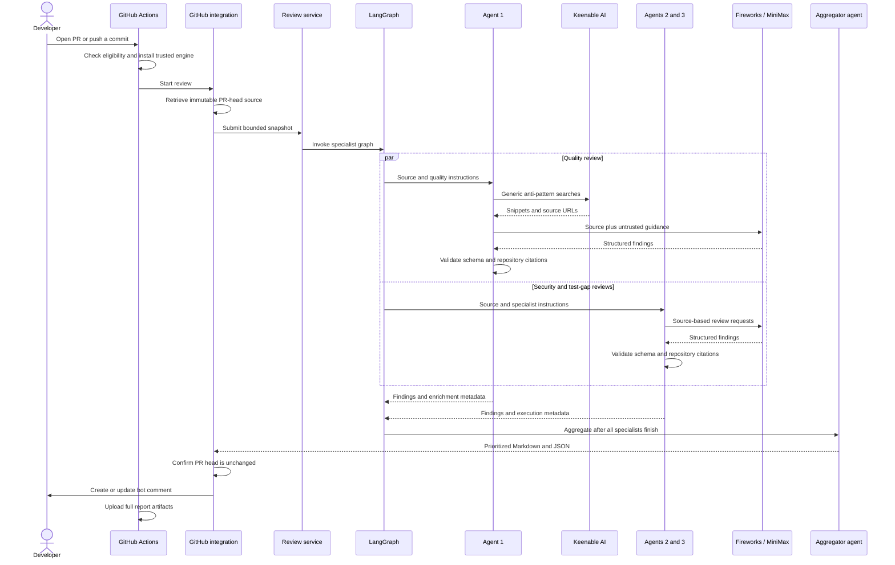

# Pull request to review report: execution flow

Updated: 25 October 2026. Includes Keenable enrichment for Agent 1.

## Sequence



## 1. GitHub receives the event

The target repository's `.github/workflows/ai-code-review.yml` handles PR events
`opened`, `synchronize`, `reopened`, and `ready_for_review`. Its template is in
this project's `integrations/github/` folder.

Only non-draft, same-repository PRs from eligible actors proceed. Fork and
Dependabot PRs are skipped. A per-PR concurrency group cancels an older run when
a newer run starts.

## 2. Actions installs the trusted engine

The workflow checks out the current default branch with persisted checkout
credentials disabled. It installs the vendored engine and knowledge extra:

```bash
python -m pip install "./.github/coding-review[knowledge]"
```

The source of the review engine is the trusted default branch, not the PR head.
An initial installation without a trusted engine emits a bootstrap notice and
skips inference. The review step receives the Fireworks secret, sets
`KEENABLE_ENABLED=true`, and optionally receives `KEENABLE_API_KEY`.

## 3. The integration retrieves source

The review step runs:

```bash
python -m coding_review.integrations.github review
```

`coding_review/integrations/github.py` reads PR metadata, confirms repository and
head eligibility, and retrieves the Git tree and supported source blobs at the
immutable head commit. It rejects unsupported entries and oversized snapshots.

The output is a path-to-source mapping. The scope is all selected source files,
not only the diff. No PR dependencies are installed and no PR application code
or tests are executed.

## 4. The service initializes the run

`service.py` accepts the snapshot and validated `ReviewConfig`, assigns a run ID,
records timestamps and byte size, and computes the snapshot SHA-256. It obtains
the configured backend and invokes the graph with the concurrency setting.

`domain.py` supplies the `Finding`, `Review`, `AgentResult`, and `State` contracts.
The graph state contains the files, accumulated specialist results, and report.

## 5. LangGraph fans out

`graph.py` creates quality, security, and tests nodes through
`agents/reviewer.py`, then joins all three at the aggregator agent. The graph normally
allows three concurrent specialists; the configured limit can serialize them.

Each invocation owns its reviewer and model metadata. A provider failure becomes
a failed agent result so the other specialists can still contribute findings.

## 6. Agent 1 enriches its context

The quality and security nodes call `agents/knowledge.py` independently. When enabled, it derives
languages from file extensions and performs at most two generic anti-pattern
queries using the Keenable SDK. Repository text and filenames are not searched.

At most six source records are retained, with snippets capped at 1,200 characters.
The snippets are labeled untrusted reference data and appended to the source
message. They supplement the quality instructions in `agents/prompts.py`.

If Keenable is unavailable, source-only quality review continues. Its limitation
and enrichment status make this degradation visible. The security agent independently retrieves official OWASP Top 10:2025, CWE
Top 25:2025, and, for Swift/Kotlin, OWASP MASVS guidance. Test-gap review receives
no Keenable guidance. Security searches are bounded to three generic queries and
six official sources, with status and sources retained in report metadata.

## 7. Specialists call the model

`agents/context.py` supplies exact source strings with explicit one-based line
coordinates. `agents/reviewer.py` combines that context with shared policy and
the appropriate specialty, then requests structured output.

`backends/factory.py` selects the adapter. In the deployment,
`backends/fireworks.py` calls MiniMax M3.1 Flash using JSON-schema responses,
low reasoning effort, and a 32,768-token completion budget including reasoning.
It retains requested and provider-reported model information.

## 8. Responses and evidence are validated

The reviewer validates the `Review` schema, then checks findings through
`agents/evidence.py`. Every retained finding requires an exact repository excerpt.
Unique same-file matches can repair line coordinates or common-margin indentation;
ambiguous or fabricated citations are discarded and disclosed.

Keenable text cannot serve as repository evidence. Citation validity establishes
source location, not correctness of the reasoning. Each `AgentResult` records
status, findings, limitations, duration, model metadata, citation corrections,
and, for quality, knowledge-enrichment metadata.

## 9. The aggregator agent synthesizes

After all three nodes return, `agents/aggregator.py` invokes the deterministic
merge in `reporting/aggregation.py`, which checks that each expected
specialist succeeded. It merges matches by file, line, and normalized title,
preserves contributing agents, and retains the highest assigned severity.

Findings sort by critical, high, medium, low, then info, with stable location/title
tie-breakers. The report is incomplete if any expected specialist failed. This
step does not invoke an LLM. The aggregator adds a synthesis summary, up to
five ranked priorities, shared-finding counts, completed/failed/missing agent
lists, and consolidated limitations to the JSON report. Markdown presents the
summary, priorities, and review gaps before the detailed evidence.

## 10. Reports are written

`reporting/rendering.py` produces Markdown, including model provenance and Agent
1's Keenable status/source section. JSON retains detailed execution metadata.
`reporting/writer.py` uses temporary files and atomic replacement.

The GitHub integration writes the report files under `review-output/` and includes
the reviewed commit. The service's snapshot hash identifies the selected source
mapping; it does not cover omitted files or make model output deterministic.

## 11. The bot comment is published

A separate workflow step invokes:

```bash
python -m coding_review.integrations.github publish
```

The integration confirms the current PR head still matches the reviewed commit.
Stale reports are not posted. It creates a marked bot comment or updates the
existing marked comment belonging to `github-actions[bot]`, leaving human comments
untouched. HTML and mention syntax are escaped before publication.

The publish step can run after inference failure if report JSON exists, so partial
results and diagnostics remain visible.

## 12. Actions retains outputs and finishes

The workflow uploads complete Markdown and JSON artifacts for 14 days. All three
specialists must succeed for a complete review. Findings are advisory and do not
independently fail the check. Keenable degradation is disclosed but does not alone
make an otherwise successful review incomplete.

## Reading a result

| Question | Where to check |
| --- | --- |
| Which source was reviewed? | Reviewed commit and snapshot hash |
| Did all three agents finish? | Report status and individual agent statuses |
| Did Keenable actually contribute? | Quality agent enrichment status and sources |
| Which model answered? | Actual-model provenance for each agent |
| Which issues need attention? | Severity-ordered findings and recommendations |
| Were source coordinates repaired? | JSON citation-correction audit |
| Did any stage degrade or fail? | Limitations and structured diagnostics |
| Were tests executed? | They were not; test analysis is static |

## Recorded live verification

The [PR #3 report](https://github.com/krishnakumar2050/Week1Project-GenAcademy/pull/3#issuecomment-6391208210)
and [Actions run](https://github.com/krishnakumar2050/Week1Project-GenAcademy/actions/runs/40145262764)
verified all three specialists and `Keenable status: ok`, with six retrieved
sources. Agent 1 identified intentional mutable-default and swallowed-exception
patterns. Review duration was approximately 42 seconds. PR #3 was subsequently
closed without merging, and the test branch was deleted.

See [the project brief](project-brief.md) for objectives, configuration, module
responsibilities, safeguards, and limitations.
