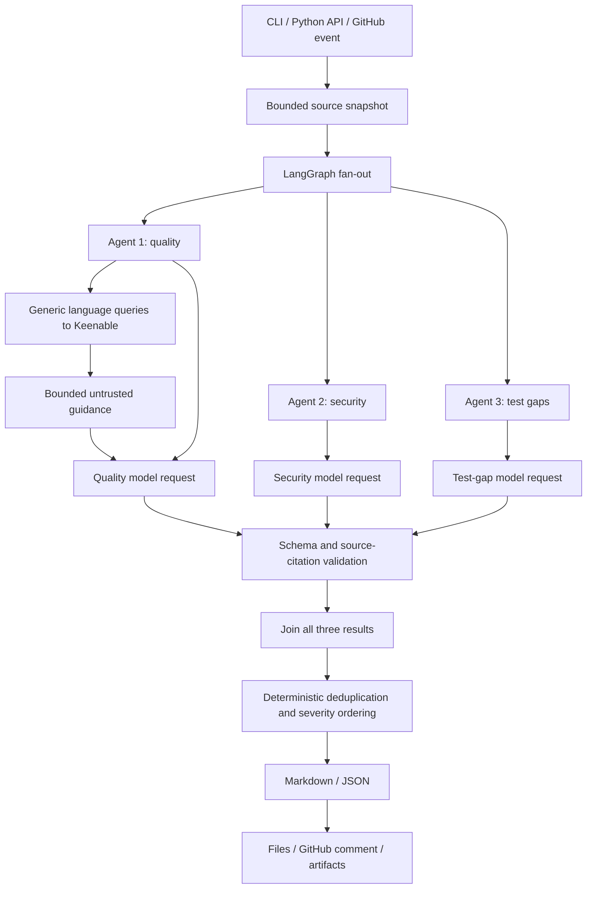

# Multi-agent code review: project brief

Updated: 25 October 2026.

## Purpose

This project automates source-code review using three specialist agents coordinated
by LangGraph. It identifies correctness defects, security vulnerabilities, and
missing tests, then combines source-supported findings into a prioritized report.
It supports a local CLI, a Python API, and GitHub pull-request automation.

The deployed GitHub integration in `krishnakumar2050/Week1Project-GenAcademy` uses
MiniMax M3.1 Flash through Fireworks AI. Agent 1 can enrich its analysis with
external anti-pattern guidance retrieved through Keenable AI.

## Objectives

- Provide complementary quality, security, and test-gap reviews of one snapshot.
- Require verifiable repository citations for every retained finding.
- Explain concrete failure scenarios and recommend actionable fixes or tests.
- Expose partial failures rather than treating them as clean reviews.
- Record source, commit, model, and execution provenance.
- Publish repeatable PR feedback without executing PR application code.

## Specialist responsibilities

| Component | Objective | Context |
| --- | --- | --- |
| Agent 1: quality | Find correctness bugs, error-handling defects, and actionable anti-patterns; name the pattern and recommend refactoring | Source plus optional Keenable guidance |
| Agent 2: security | Identify evidenced vulnerabilities, attack preconditions, impact, and remediation | Source |
| Agent 3: tests | Identify missing behavioral, edge-case, and failure-path tests, including expected assertions | Source and supplied tests |
| Orchestrator | Check completion, merge exact duplicates, and prioritize results | Validated agent results |

The test agent performs static analysis. It does not execute tests or measure
runtime coverage. Model findings still require human review.

## Architecture



LangGraph runs independent specialist nodes and waits at an explicit join barrier.
The orchestrator uses deterministic Python logic; it makes no additional model
request. Concurrency is configurable from one to three.

## Modules and folder objectives

| Location | Responsibility |
| --- | --- |
| `coding_review/cli.py` | CLI arguments, application composition, and exit codes |
| `coding_review/config.py` | Immutable validated settings |
| `coding_review/service.py` | Review use case, run identity, timestamps, and source hash |
| `coding_review/domain.py` | Findings, agent results, severity, and shared state |
| `coding_review/graph.py` | Specialist nodes, fan-out, and completion barrier |
| `coding_review/sources.py` | Local source selection, exclusions, and size limits |
| `coding_review/agents/prompts.py` | Shared policy and specialist instructions |
| `coding_review/agents/context.py` | Exact source strings with explicit line coordinates |
| `coding_review/agents/knowledge.py` | Optional Keenable retrieval and enrichment metadata |
| `coding_review/agents/reviewer.py` | Specialist invocation, validation, timing, and failures |
| `coding_review/agents/evidence.py` | Exact evidence verification and unambiguous correction |
| `coding_review/backends/` | Fireworks, OpenAI API, and Codex CLI adapters |
| `coding_review/reporting/` | Aggregation, rendering, and atomic report writing |
| `coding_review/integrations/github.py` | Immutable PR source retrieval and report publication |
| `integrations/github/` | Installation guide and deployable workflow template |
| `.github/workflows/ci.yml` | CI checks for the reviewer itself |
| `tests/` | Review-engine regression tests using fake providers |
| `examples/` | Sample application and its behavioral/security regression tests |

The installed target repository vendors the engine under `.github/coding-review/`
and places the review workflow in `.github/workflows/ai-code-review.yml`.
Local changes must be explicitly deployed to that vendored copy.

## Keenable enrichment for Agent 1

The enrichment module derives languages from supported file extensions and searches
for generic anti-pattern guidance. It does not include repository code, filenames,
paths, or identifiers in queries.

Retrieval is bounded to at most two language queries and six retained sources.
Each retained snippet is capped at 1,200 characters; the SDK timeout is ten seconds.
The verified optional dependency is `keenable==0.1.1`.

Retrieved text is marked as untrusted reference data. Agent 1 is instructed to
ignore embedded commands, apply only relevant guidance, explain concrete failures,
and recommend refactoring. Web content never replaces repository evidence.
Search sources are not restricted to an official-documentation allowlist.

The quality agent records queries, sources, snippets, status, and a sanitized
exception type when retrieval fails in `execution.knowledge_enrichment`.
Markdown displays the enrichment status and source list.

If retrieval fails or yields no usable sources, source-only review continues and
reports the limitation. A complete review does not necessarily mean enrichment
succeeded: inspect the separate Keenable status.

### Local configuration

```bash
.venv313/bin/python -m pip install -e '.[knowledge]'
export KEENABLE_ENABLED=true
# Optional: export KEENABLE_API_KEY='your-keenable-key'
export FIREWORKS_API_KEY='your-fireworks-key'
.venv313/bin/python -m coding_review ./examples --output review-report.md
```

The SDK supports keyless requests; an optional key changes service limits.
Unset `KEENABLE_ENABLED` to disable enrichment. Environment variables must be set
in the invoking process; the application does not automatically load a `.env` file.

### GitHub configuration

The trusted workflow installs `./.github/coding-review[knowledge]` and sets:

```yaml
KEENABLE_ENABLED: 'true'
KEENABLE_API_KEY: ${{ secrets.KEENABLE_API_KEY }}
FIREWORKS_API_KEY: ${{ secrets.FIREWORKS_API_KEY || secrets.CODINGAGENT }}
```

The optional Keenable credential and the Fireworks credential serve separate
providers. GitHub inference uses Fireworks billing, not ChatGPT Pro.

## Evidence and prioritization

Every finding includes severity, title, relative path, one-based line number,
exact source evidence, explanation, recommendation, and an optional suggested test.
Unique matching excerpts in the same file can repair location or common-margin
indentation errors. Corrections are audited. Ambiguous or fabricated evidence is
rejected. Citation validity does not prove reasoning correctness.

Severity order is critical, high, medium, low, then info. Agents assign severity;
the orchestrator sorts deterministically. Findings merge only when file, line,
and normalized title match. A merged finding records contributing agents and
retains the higher severity. Semantic duplicates may remain.

Completion requires exactly one successful result from every expected specialist.
Specialist failures produce an incomplete report with available findings and
failure diagnostics. Exit code 0 means complete execution, not zero findings;
exit code 2 indicates an incomplete review or application/configuration error.

## GitHub operation and trust boundaries

The workflow handles eligible same-repository PR events and skips drafts, forks,
and Dependabot PRs. It loads the review engine from the current trusted default
branch and retrieves source at the immutable PR-head commit. PR application code
is not executed, imported, or installed. Collaborator workflow changes remain
subject to GitHub Actions' normal trust model.

The selected full-source snapshot is reviewed, not just changed lines. Supported
files are bounded by a 120,000-byte default source budget. Dotfiles, symlinks,
and common generated directories are excluded. Local selection does not interpret
`.gitignore`. Selected source is transmitted to the configured model provider.

Publication checks that the PR head has not changed, escapes HTML and mentions,
and updates only the integration's marked `github-actions[bot]` comment. GitHub
permissions are `contents: read` and `pull-requests: write`. Markdown and JSON
artifacts are retained for 14 days. Findings are advisory; an incomplete review
fails the check, while severity alone does not block merging.

## Reporting and observability

Reports record schema version, run ID, timestamps, duration, snapshot hash and
size, selected files, severity counts, findings, per-agent limitations, citation
corrections, and requested versus actual model information. GitHub runs include
the reviewed commit. Provider errors expose useful status/code/request IDs when
available, with known credentials redacted. Files are published atomically.

## Verified deployment

The 25 October 2026 verification passed 131 local tests and lint checks. A live
Keenable search succeeded locally and in GitHub Actions, retaining six sources.
All three specialists completed with provider-reported model
`accounts/fireworks/models/minimax-m3p1-flash`.

[Test PR #3](https://github.com/krishnakumar2050/Week1Project-GenAcademy/pull/3)
produced 22 retained model findings: one high, 16 medium, four low, and one info.
Agent 1 identified the intentional mutable-default and swallowed-exception
patterns as informational because the file was explicitly a test fixture.
These counts are a historical verification result, not independently confirmed
application defects or a guarantee of future output.

- [Published report](https://github.com/krishnakumar2050/Week1Project-GenAcademy/pull/3#issuecomment-6391208210)
- [Successful Actions run](https://github.com/krishnakumar2050/Week1Project-GenAcademy/actions/runs/40145262764)
- Deployed revision: `b8e66725d50861af3ad2f49d658a75bd5cd84e86`.

PR #3 was closed without merging and its test branch deleted. The integration
remains on `main`; the intentionally defective fixture was not merged.

## Limitations and next steps

The implementation does not provide measured coverage, dedicated dependency
scanning, large-repository chunking, durable queues, multi-tenant isolation, or
semantic deduplication. Prompt injection and model reasoning errors remain possible.
Keenable adds an external dependency, variable retrieval quality, and latency.

Useful next steps include changed-line-aware prioritization, known-defect
evaluations, coverage ingestion, configurable severity gates, broader dependency
locking, and cost monitoring.

See [the end-to-end execution flow](execution-flow.md) for the runtime walkthrough.
